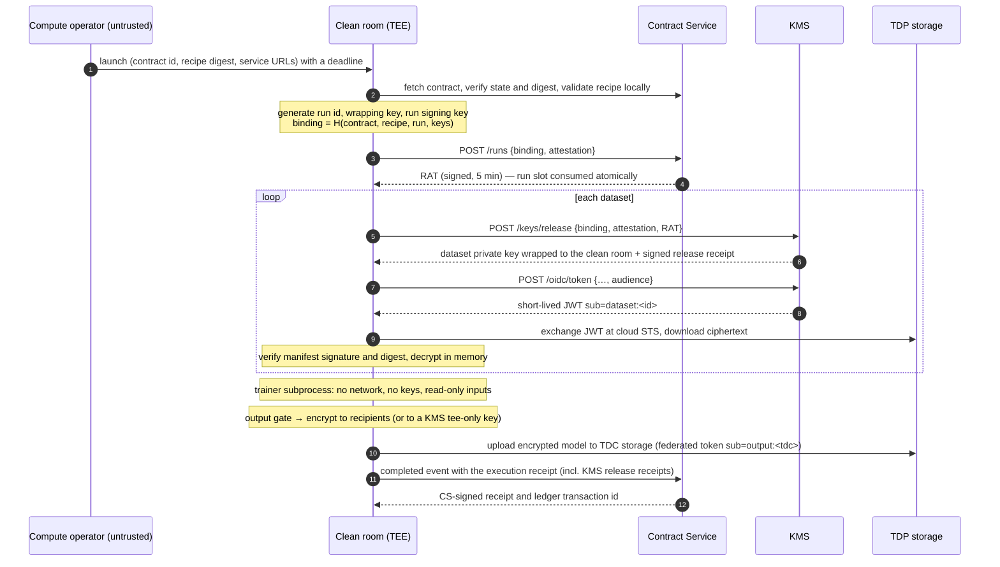

# DEPA Training v2 — Technical Architecture

This document explains how the system works and why. The precise wire formats and checks are
in the normative [protocol specification](specs/protocol.md). What the design defends against is
in the [threat model](threat-model.md).

## 1. Three planes, three operators

| Plane | Operated by | Components | Trusted with plaintext? |
|---|---|---|---|
| **Governance** | Data Collaborative (DC) | Contract Service (CS) and KMS: CCF apps on Azure Confidential Ledger (ACL) | No. They hold keys, and only inside CCF's TEEs. |
| **Data** | Each Training Data Provider (TDP) | Own storage (Azure Blob, S3, GCS, HTTPS) holding `dedf/1` encrypted datasets; IAM trust for KMS-issued tokens | No. Storage holds only ciphertext. |
| **Compute** | TDC or a clean-room provider | Time-bound clean rooms on AKS + virtual nodes v2 → confidential ACI (`aci-snp`), or GCP Confidential Space (`gcp-cs-tdx`) | Only inside the attested TEE |

No single operator can get plaintext. The compute operator controls scheduling and networking,
but never holds keys. The DC services release keys, but only to attested clean rooms under
contracts the data owners signed. Storage operators see only ciphertext, and their IAM admits
only tokens the KMS mints for such clean rooms.

## 2. Components

| Component | Where | Responsibility |
|---|---|---|
| **Contract Service** | `contract-service` repo, ACL | Party registry, dataset catalogue (descriptors and manifest digests), contracts and signatures, run authorisation (issues the *Run Authorisation Token*, RAT), run events, execution receipts |
| **KMS** | `depa-training-kms-azure` repo, ACL | One HPKE key pair per dataset; owner-authored release policies; the single atomic key-release check; OIDC issuer for storage federation; output keys for `tee-only` models; clean-room release registry |
| **Clean-room agent** (`depa-ccr`) | `sdk/python/src/depa/ccr` | In-TEE orchestration: attest, authorise, obtain keys and storage tokens, verify and decrypt data, run the trainer in a sandboxed subprocess, gate and encrypt outputs, post receipts |
| **Training runtime** (`depa-train`) | `trainers/` | Tiered, declarative execution of recipes through vetted plugins |
| **SDK / CLI** (`depa`) | `sdk/python` | For every party: keys, encryption, publishing, policies, contracts, governance, job submission, receipts, model retrieval |
| **Clean-room releases** | `ccr/` | Reproducibly built images per trainer family (`classic`, `torch`, `llm`). Measurements (CCE policy hash / image digest) are approved by DC governance. |
| **Terraform** | `deploy/`, service repos | DC services, TDP storage and federation, TDC compute, for each cloud |

## 3. Lifecycle

### 3.1 Forming a collaborative
The DC operator deploys both CCF apps on ACL and bootstraps them with the founding members and
a voting threshold. From then on, every change goes through member proposals and ballots,
applied atomically when the threshold is reached: admitting parties, approving clean-room
releases, pinning the peer service's signing keys, configuring JWT issuers. The ACL
Administrator role is used only to deploy reproducibly built app bundles. Their digests are
approved by governance and audited (see the threat model).

### 3.2 Publishing a dataset (TDP)
1. `depa dataset create-key` asks the KMS to create the dataset's HPKE key pair. Only the public key leaves the KMS.
2. The TDP sets the release policy: allowed platforms, tiers, consumers, purposes, DP floor, output modes, storage audiences, expiry.
3. `depa dataset encrypt` encrypts locally into `dedf/1`. A fresh data key is sealed to the dataset public key, every file is encrypted with authenticated streaming encryption, and a manifest is signed by the owner.
4. Upload to the TDP's own storage, and configure that cloud's IAM to trust the KMS issuer for `sub = dataset:<id>` (Terraform modules provided).
5. Publish the descriptor (location, schema, federation details, manifest digest) to the CS catalogue.

### 3.3 Contracting
The TDC proposes a contract. It references exact dataset versions (by manifest digest), the
recipes (embedded, by digest), allowed clean-room releases and platforms, privacy parameters,
output mode and recipients, a time window, `max_runs` and `max_duration_minutes`. Each dataset
owner verifies it (`depa contract verify`) and signs. When the last signature lands, the
contract becomes active. Any signatory can revoke it, and every dataset owner can also suspend
their dataset at the KMS independently.

### 3.4 A training run

### 3.5 Binding, and the single atomic check
- The **binding** hashes the contract and its digest, the recipe digest, the run id, the platform,
  the clean room's ephemeral wrapping key and its run signing key. It is placed in the hardware
  evidence: SNP `REPORT_DATA` on ACI, or the `eat_nonce` of Google's attestation token on
  Confidential Space. So every token and key is tied to one specific TEE instance and run.
- The clean-room image is **generic**: one measured release serves every contract. Contract
  specificity comes from the binding, not from per-contract images. TDPs don't need to approve
  a new measurement for each contract, yet a key can never be used outside the run that requested it.
- **The CS and KMS stay separate but enforce jointly.** The CS decides "may this contract run
  now?" (state, validity, run budget, recipe, release) and issues a short-lived RAT signed with
  its in-CCF key. The KMS pins the CS's public keys through governance. In **one CCF
  transaction**, the KMS verifies the attestation, the binding, the RAT, the release registry,
  the dataset's owner policy and suspensions, then records the release.
  The CS in turn pins the KMS's keys and accepts a completed run only with valid KMS release
  receipts for every dataset. Each service verifies the other's collateral, and either one alone
  can stop a run.

### 3.6 Storage federation: data released only into the attested clean room
Data is protected cryptographically, so storage need not be trusted. On top of that, access to
the ciphertext is restricted: the KMS is an OIDC issuer, and each TDP's own cloud IAM (AWS IAM
OIDC provider, GCP Workload Identity Federation, Entra federated credentials) trusts only tokens
with `sub = dataset:<id>`. The KMS mints those only when the same checks as key release pass. No
long-lived credentials exist anywhere, and the trust is configured once per dataset rather than
per contract. One caveat: CCF can sign only ES256, while Entra accepts RS256 only. Until CCF adds
RS256, an Azure-hosted TDP therefore runs a small SAS broker in its own subscription. The broker
checks the KMS token and returns a short-lived SAS scoped to the dataset (spec §10.1). Because the discovery and JWKS endpoints must have a publicly trusted certificate,
they are served through an Application Gateway, and their integrity is checked against the JWKS
published on the ledger.

### 3.7 Outputs and provenance
- **Output gate:** only declared outputs in contract-allowed formats (safetensors, ONNX, skops,
  XGBoost JSON, Keras safe format), within the size cap, with metrics filtered to the contract
  allowlist and privacy spent within the contract.
- **Output modes** (negotiated in the contract):
  - `tdc`: encrypted to the consumer's registered keys.
  - `tee-only`: encrypted to a KMS-held key that is released only to attested DEPA-inferencing clean rooms. The model never leaves a TEE.
- **Execution receipt:** inputs (with KMS release receipts), recipe, measurement, platform, privacy
  spent, output digests, metrics. Signed by the run key, verified and countersigned by the CS, and
  anchored in the ledger. Together with contract signatures and key-release records, this gives
  end-to-end, independently verifiable provenance for every model.

### 3.8 Time-bound clean rooms
Training is a batch job, not a service. Each clean room executes exactly one run and exits.
Bounds are enforced at four layers:
- the contract's `max_duration_minutes`;
- the CS run deadline (late events are rejected);
- the agent's watchdog;
- the platform: Kubernetes `activeDeadlineSeconds` on AKS/VN2, or `max-run-duration` with delete-on-termination on GCP.

## 4. Clean rooms

- **One container image per trainer family.** It contains the agent and the trainer runtime,
  because Confidential Space runs a single container and the same artifact should run on both
  platforms. It runs unprivileged: no dm-crypt sidecar, since data is decrypted per file, in
  memory, by the agent.
- **Platforms:**
  - **Azure:** AKS with virtual nodes v2 schedules a Kubernetes Job onto confidential ACI. The CCE policy annotation pins the image layers, the command and the allowed environment. The policy's hash is the measurement. This is the stack DEPA-inferencing runs in production.
  - **GCP:** Confidential Space on C3 (Intel TDX). The measurement is the image digest. Google Cloud Attestation issues the OIDC token, which the KMS validates through the issuer configured on the ACL instance.
  - **Local development:** a `virtual` platform that governance must explicitly enable and dataset policies must explicitly list. It is never valid for production data.
- **Sandboxing inside the TEE:** the trainer runs as a separate unprivileged process with no
  credentials, a scrubbed environment, read-only inputs and a single output directory. Production
  releases disable stdio; the agent emits only allowlisted status lines.
- **Future:** a Kata Confidential Containers backend, for cloud-agnostic clean rooms and confidential GPUs, plugs in as another `platform` with its own verifier. Nothing else changes.

## 5. Training: universal yet automatically checkable

Arbitrary training code can exfiltrate data through the network, logs or the model itself, and
code cannot be proven harmless in general. DEPA Training therefore shrinks what untrusted input
controls, until the rest can be checked automatically:

| Tier | Consumer supplies | Checked automatically | Covers |
|---|---|---|---|
| **1. Declarative recipe** | Configuration only | Schema per plugin, class allowlists, safe formats, SQL allowlist, DP parameters vs contract | SQL joins (DuckDB), scikit-learn, XGBoost (+DP), PyTorch / Lightning (+Opacus), Keras 3 (TF/JAX/PyTorch backends), LoRA fine-tuning of language models |
| **2. Graph-only model/loss** | An exported compute graph, no Python | Every op against an allowlist; the harness owns data, optimiser, DP and output | Custom architectures and losses |
| **3. Approved custom code** | A container image approved by digest in the contract | Output gate, receipts, DP if required; each TDP's policy must accept the measurement | Anything else |

Plugins are reviewed once and shipped inside measured releases, so coverage grows through one
review per plugin rather than one per job. Recipes are embedded in contracts by digest, so TDPs
sign the exact computation. No pickle formats are accepted anywhere.

## 6. Governance on Azure Confidential Ledger

ACL provides CCF's integrity and confidentiality, plus a managed operation, but it doesn't expose
CCF member governance. Both apps therefore implement **app-level, n-of-m governance**: signed
proposals and ballots, thresholds per action, an audit trail on the ledger. One invariant
protects providers: **governance can tighten but never loosen a data owner's control**. It can
suspend a dataset or revoke a release, but it cannot alter a dataset's policy, keys or a signed
contract.

## 7. Relationship to other systems

- **DEPA Inferencing:** same infrastructure (AKS + VN2 + confidential ACI, CCE policies, CCF KMS
  on ACL, the Google attestation issuer for GCP). The `tee-only` output mode hands trained models
  to inferencing clean rooms, so the model never leaves a TEE.
- **Azure Confidential Clean Rooms:** Microsoft's related effort. It runs per-collaboration
  governance on its own CCF network and is centred on Azure-managed analytics. It also uses a
  governance-service OIDC issuer for storage access, the pattern adopted here. DEPA Training
  differs in:
  - collaborative-level (multilateral) governance;
  - techno-legal contracts with owner-held release policies;
  - tiered training with differential privacy;
  - multi-cloud storage and clean rooms;
  - an open public-infrastructure orientation.
